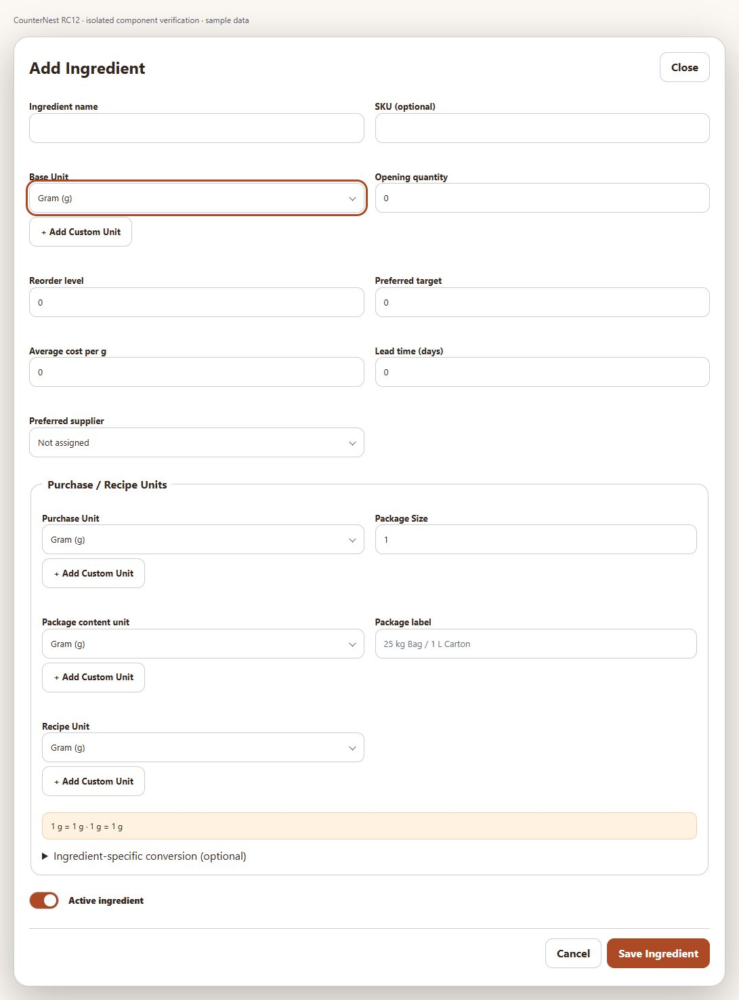
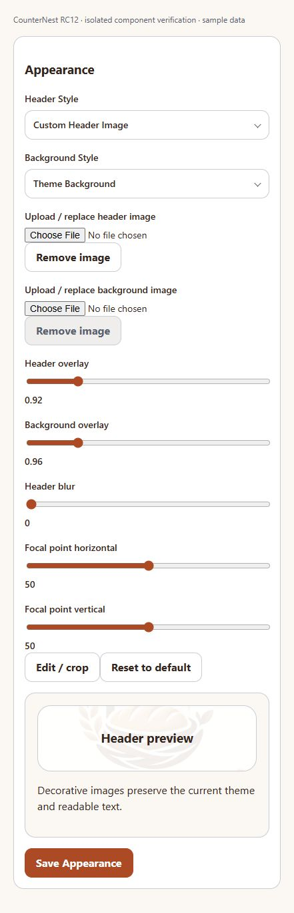
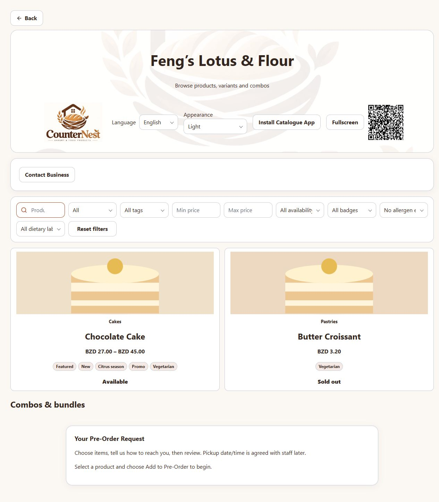
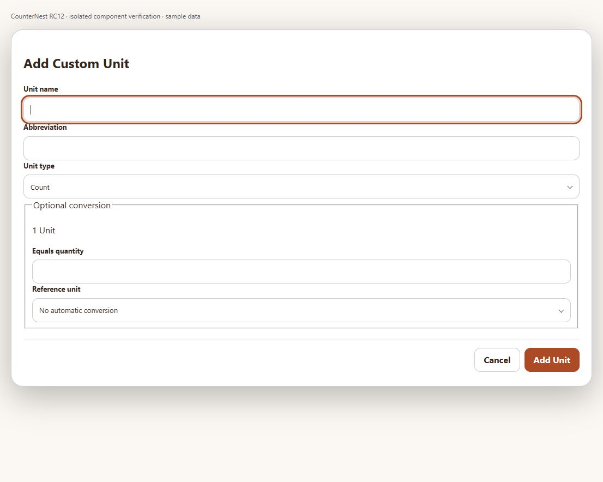
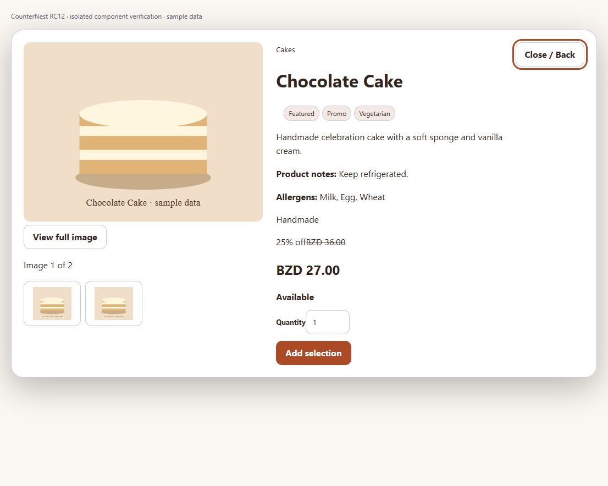
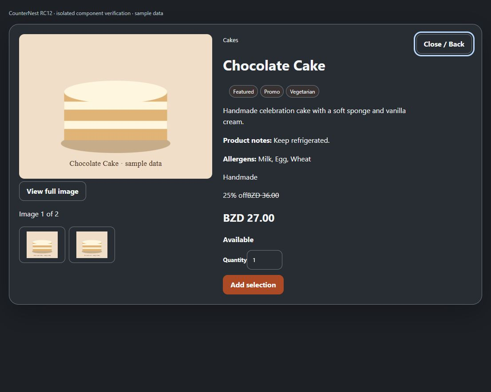
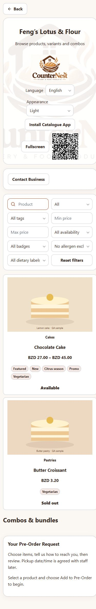
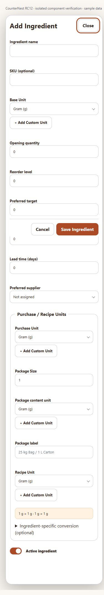
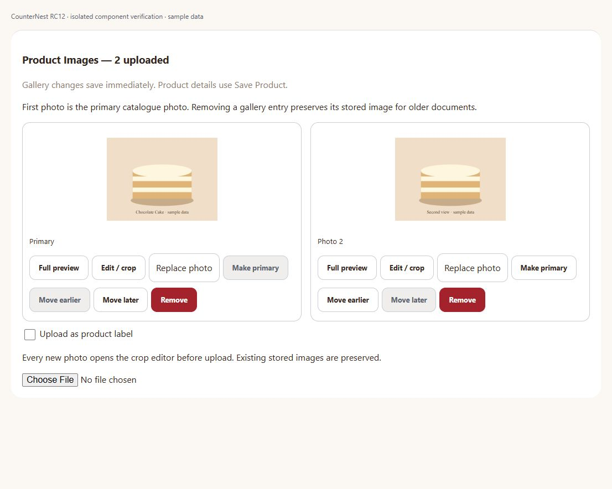
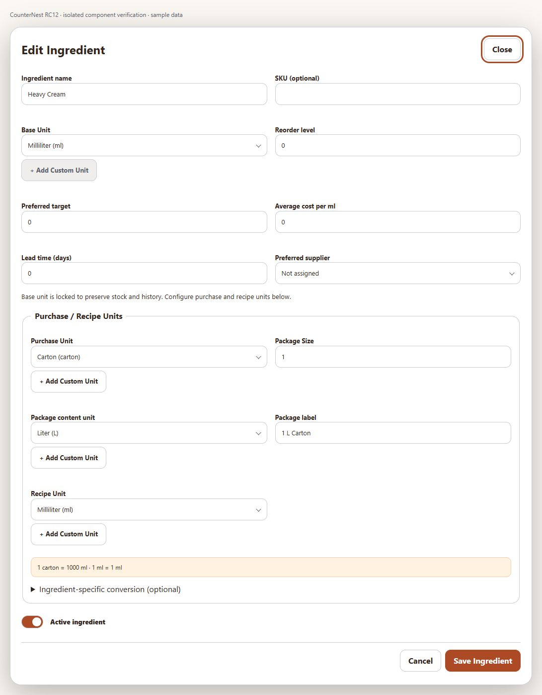

# RC12 screen evidence

Actual components with isolated sample data; see SCREENSHOT_EVIDENCE.md for scope. The complete catalogue was also checked at 390, 768 and 1280 px without horizontal overflow.

## add ingredient

## catalogue appearance controls

## catalogue custom header

## custom unit modal

## customer product detail

## dark mode

## mobile catalogue

## mobile ingredient

## product gallery manager

## purchase unit setup

